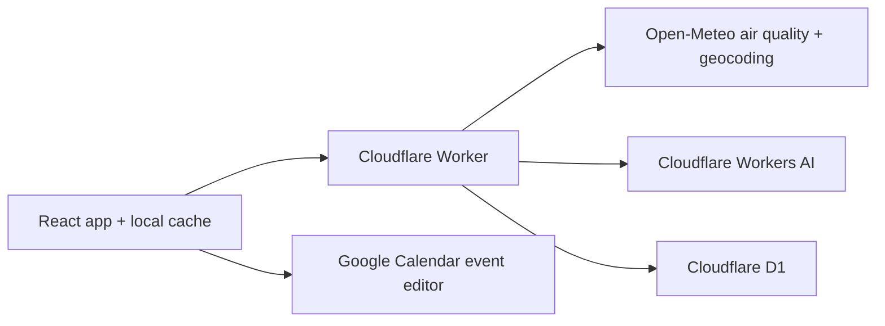

# HawaPlan — Urban Air Quality Assistant

**Challenge 6 · Urban Air Quality Assistant**

HawaPlan helps families make practical plans during winter smog. It combines a location-aware air quality forecast, a deterministic outing planner, indoor and low-emission suggestions, and a grounded AI assistant. The user can make a plan for one day or a 7- or 30-day routine, save it, and review a prefilled Google Calendar event.

**Live app:** [hawaplan.harshgupta24716.workers.dev](https://hawaplan.harshgupta24716.workers.dev)

**Demo video:** [35-second HawaPlan overview](https://github.com/harsh-gupta-10/hawaplan/releases/download/v0.1.0/hawaplan-demo.mp4). This is an animated feature walkthrough; use the live app for hands-on interaction.

## The problem and persona

The primary user is a parent or caregiver who must arrange school runs, errands, walks, or exercise while outdoor air quality changes through the day. They need a useful choice that respects their schedule and family needs, not a generic warning to stay inside. A school or neighborhood group can also copy a short community note about combining trips and avoiding idling.

## What the app does

1. **Find the relevant area.** On first visit, the app uses Cloudflare's approximate network city when available. The user can grant browser geolocation permission or search for a city. Device coordinates are rounded before storage.
2. **Choose a day and constraints.** The user selects a date, one day / seven days / 30 days, activity, preferred hour, duration, time flexibility, travel mode, and whether someone needs extra care. School routines default to weekdays; the user can change this.
3. **Compare feasible windows.** HawaPlan compares modeled outdoor PM₂.₅ at the preferred time with the lowest modeled window that fits the selected date, duration, flexibility, and practical outing hours. Fixed commitments stay fixed.
4. **Act on the result.** It separates an ambient air comparison from an emissions suggestion and an indoor alternative. The user can save the plan, ask follow-up questions, or review a prefilled Google Calendar event. Week and month calendars use a bounded recurring event.
5. **Keep the work.** Guest plans, preferences, chat, and drafts persist in this browser. An optional username and password account syncs plans, preferences, and chat through Cloudflare D1.

The chart shows the next 12 hours. The longer schedule lists each selected day; dates without a supported forecast show the preferred routine time and a prompt to recheck closer to the outing.

## Decision logic and GenAI

The actual time comparison is deterministic in [src/shared/planner.ts](src/shared/planner.ts). It filters out past hours, keeps candidates on the chosen date, enforces the user's flexibility, excludes impractical overnight flexible slots, and computes a duration-weighted PM₂.₅ average. The displayed percentage compares **modeled outdoor ambient concentration between two time windows**. It is not a measured reduction in personal exposure, emissions, or health risk.

**GenAI service:** Cloudflare Workers AI, using the **@cf/google/gemma-4-26b-a4b-it** model in [src/worker/index.ts](src/worker/index.ts) at **POST /api/ask**. The assistant receives a fresh forecast, the computed plan facts, the user's question, and a short conversation history. Its system instructions restrict numerical claims to those supplied facts, explain tradeoffs, and avoid medical diagnosis. AI is used for contextual explanations and follow-up advice; it does not invent the forecast or choose the winning time window.

## Architecture



The React app and static assets are served by Cloudflare Workers Static Assets. One Worker handles forecasts, geocoding, approximate location, AI, authentication, and sync. Open-Meteo and the Google Calendar event link require no API key. A service worker caches the app shell and static files; the browser and Cloudflare edge cache forecasts. Authentication and account data responses are never cached by the service worker.

## Repository layout

```text
src/app/       React UI, account flow, local persistence, styles
src/shared/    Planner, schedule, and saved-data logic shared with the Worker
src/worker/    API routes, authentication, D1 sync, Workers AI
public/        PWA service worker, manifest, icon
migrations/    D1 schema
tests/         Planner, schedule, and sync tests
docs/PLAN.md   Product scope, architecture, future work
.github/       CI checks for every push and pull request
```

## Run locally

Prerequisites: Node.js and npm, a Cloudflare account for Wrangler and Workers AI, and Git. No weather, route, Google Calendar, or external AI key is required.

```bash
npm install
npx wrangler login
npx wrangler d1 migrations apply hawaplan-data --local
npm run build
npm run dev:worker
```

Open **http://localhost:8787**. For UI hot reload, run **npm run dev** in a second terminal and open **http://localhost:5173**; Vite proxies /api to the local Worker. The account API uses local D1 in development.

The checked-in [wrangler.jsonc](wrangler.jsonc) targets the project owner's Cloudflare account and D1 database. To deploy a fork, create your own database with **npx wrangler d1 create hawaplan-data**, then replace **account_id** and **database_id** in that file with your account and database IDs.

## Test and deploy

```bash
npm run check
npm run deploy
```

**npm run check** runs Prettier, ESLint with React Hooks and accessibility rules, TypeScript, the production build, and the automated test suite. GitHub Actions runs the same check on pushes and pull requests. **npm run deploy** builds the UI, applies remote D1 migrations, and publishes the Worker. The project was verified with 25 automated tests, including API input validation, and live checks of forecast, AI response, signup, data sync, logout/login, deletion, calendar URL generation, and mobile layout. Local build output and dependencies are ignored by Git so the repository stays small.

## Security, accessibility, and assumptions

- Passwords are stored as salted PBKDF2 hashes. Sessions use random tokens, hashed in D1, and HttpOnly, SameSite=Lax, Secure cookies on HTTPS. Auth endpoints are rate limited; write requests check same-origin headers. The account UI supports deletion, but **does not provide email or password recovery**.
- The UI uses semantic controls and labels, keyboard-accessible form fields, and a responsive layout. It has been checked at desktop and mobile widths; a formal accessibility audit remains future work.
- Open-Meteo air quality is a broad-area CAMS model, not a street-level, indoor, or personal exposure sensor. [Its API offers up to seven forecast days](https://open-meteo.com/en/docs/air-quality-api), and some locations or model data cover fewer. A month plan is a routine, **not a 30-day air forecast**.
- Google Calendar integration opens an event draft. The user chooses the calendar and confirms Save in Google's interface; HawaPlan does not access the user's Google account or silently create events.
- The app stores the latest 100 chat messages and 30 saved plans. Offline guest data stays on the current device until the user signs in. Cloudflare free-tier daily limits can pause AI answers, while the deterministic planner remains available.
- Indoor advice follows [WHO guidance on personal interventions](https://www.who.int/news-room/questions-and-answers/item/air-pollution-personal-interventions-and-risk-communication) and [household air pollution](https://www.who.int/news-room/fact-sheets/detail/household-air-pollution-and-health). HawaPlan does not diagnose conditions or prescribe treatment.

## Next steps

Add nearby measured-station context where coverage is reliable, review local-language and accessibility support with community users, and add verified account recovery before treating this as a production identity system. See [docs/PLAN.md](docs/PLAN.md) for the extended plan.
